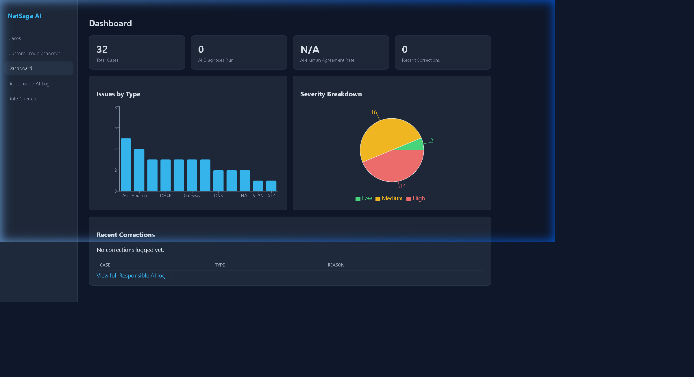

# NetSage AI - Troubleshooting Case Library Dashboard

**Author:** Vansh Kumar Soni  
**Project:** NetSage AI (Applied AI + Deterministic Network Troubleshooting Assistant)

This document provides a summary dashboard of the troubleshooting cases covered in the **NetSage AI** project, including distributions by network concept, OSI layer, severity, and the **AI Agreement Rate** (determined via human-in-the-loop review).

---

## 📊 Core Metrics

| Metric | Value | Description |
| :--- | :--- | :--- |
| **Total Cases in Library** | **32** | Total pre-seeded networking cases in the database across realistic Packet Tracer labs. |
| **AI Accepted (Agreement)** | **27** | Cases where the AI diagnosis was verified as accurate and accepted by human review. |
| **AI Corrected (Disagreement)** | **5** | Cases where the AI produced inaccurate/incomplete output and was corrected or rejected. |
| **AI Agreement Rate** | **84.38%** | Percentage of diagnoses matching the expected fault without human override. |

---

## 📸 Dashboard Interface Screenshot



---

## 🧭 Issue Type Distribution (Concept Tags)

Below is the breakdown of the 32 cases across the 12 core networking concept tags:

| Concept Tag | Case Count | Percentage | Visual Distribution |
| :--- | :---: | :---: | :--- |
| **ACL** (Access Control Lists) | 5 | 15.6% | `█████` (5) |
| **Routing** (Static / OSPF / RIP) | 4 | 12.5% | `████` (4) |
| **DHCP** (Helper Address / Scope Exhaustion) | 3 | 9.4% | `███` (3) |
| **Gateway** (IP / SVI Subnet Mismatches) | 3 | 9.4% | `███` (3) |
| **Interface** (Administrative Shutdown / Down) | 3 | 9.4% | `███` (3) |
| **Switchport** (Access Port / Default VLAN 1) | 3 | 9.4% | `███` (3) |
| **Wireless** (WPA2 Key / SSID Mismatch) | 3 | 9.4% | `███` (3) |
| **DNS** (Server IP / UDP Port 53 Reachability) | 2 | 6.3% | `██` (2) |
| **NAT** (Overload / Missing Outside Tag) | 2 | 6.3% | `██` (2) |
| **Trunking** (Allowed VLAN List / Native VLAN) | 2 | 6.3% | `██` (2) |
| **STP** (Spanning Tree Blocked Ports) | 1 | 3.1% | `█` (1) |
| **VLAN** (Missing VLAN Creation / Membership) | 1 | 3.1% | `█` (1) |

---

## 🌐 Layer Breakdown (OSI Layers)

Shows the depth of network troubleshooting covered across different layers of the OSI model:

| OSI Layer | Case Count | Percentage | Visual Distribution |
| :--- | :---: | :---: | :--- |
| **Layer 3** (Network - Routing, IPs, Subnets, Gateway) | 13 | 40.6% | `█████████████` (13) |
| **Layer 2** (Data Link - VLANs, Trunks, Switchports, STP) | 10 | 31.3% | `██████████` (10) |
| **Layer 3/4** (Network / Transport - ACLs, Port Filtering) | 5 | 15.6% | `█████` (5) |
| **Layer 1** (Physical - Interfaces Shutdown / Cable Links) | 2 | 6.3% | `██` (2) |
| **Layer 7** (Application - DNS Resolution, Service Reachability) | 2 | 6.3% | `██` (2) |

---

## ⚠️ Severity Breakdown

Categorization of troubleshooting tasks based on operational impact:

| Severity Level | Case Count | Percentage | Visual Distribution |
| :--- | :---: | :---: | :--- |
| **Medium** (Single-service block / minor segment down) | 16 | 50.0% | `████████████████` (16) |
| **High** (Complete network blackout / WAN outage) | 14 | 43.8% | `██████████████` (14) |
| **Low** (Informative / mislabeled configuration) | 2 | 6.3% | `██` (2) |

---

## 📈 Human-in-the-Loop Agreement Chart

```
AI Agreement Rate: 84.38%
[====================================>      ] 84.38% (Accepted Diagnoses: 27)
[=======>                                   ] 15.62% (Corrected / Rejected: 5)
```

The 5 corrections are fully documented in the `responsible_ai_log.md` file, demonstrating that while the LLM has high diagnostic capabilities, deterministic Python rule checks and human oversight remain essential for safe production network operations.
